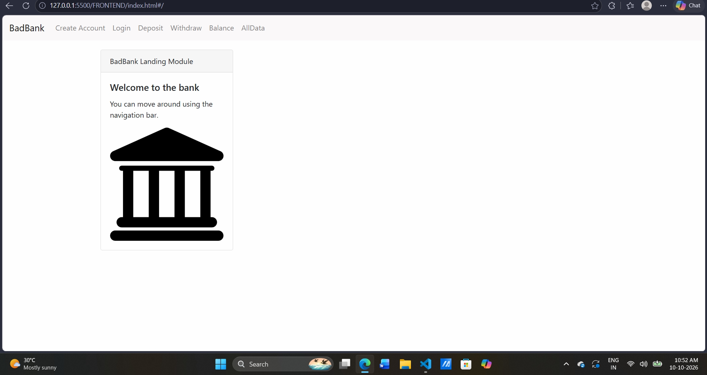
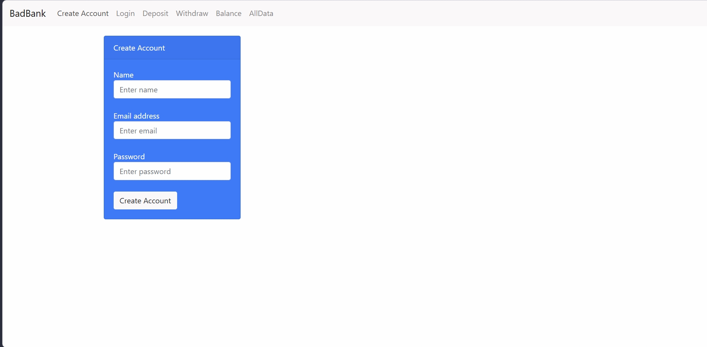
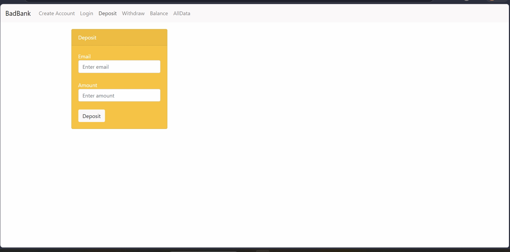
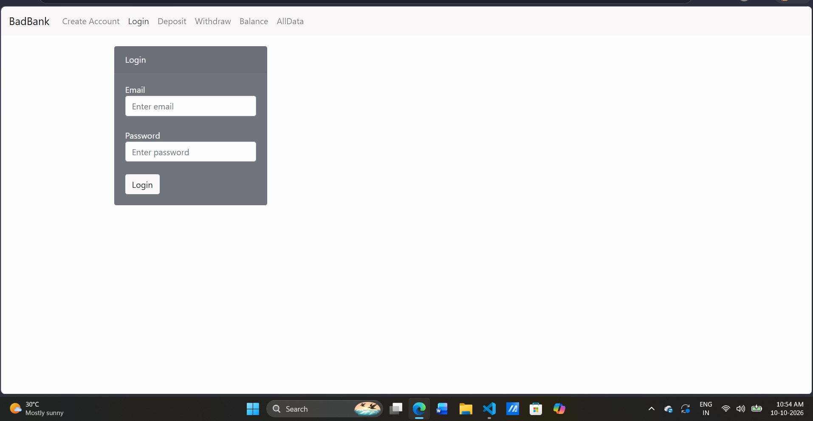
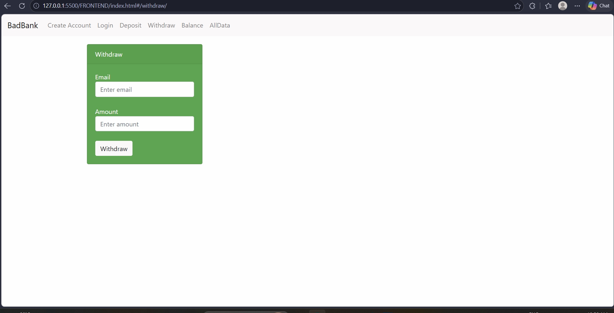
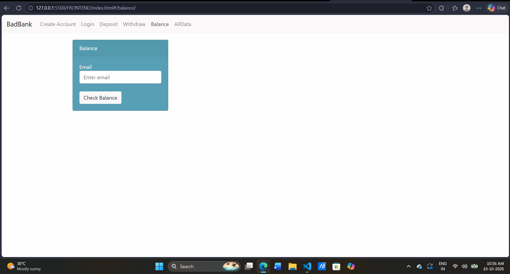

# Banking Application

## Description
This project is a full-stack banking application developed to practice software development and understand basic banking operations.

## Motivation
This project helps learners understand application development, project structure, and how frontend and backend components work together in a banking application.

## Installation Guidelines

1. Clone the GitHub repository:

   ```bash
   git clone YOUR_GITHUB_REPOSITORY_URL
   ```

2. Open the project folder in VS Code.

3. Install backend dependencies:

   ```bash
   cd BACKEND
   npm install
   ```

4. Start the backend:

   ```bash
   node index.js
   ```

5. Open a second terminal and navigate to the `FRONTEND` folder. Open `index.html` using Live Server.

## Screenshots

### homepage.png


### createaccount.png


### deposit.png


### login.png


### withdrw.png


### balance.png


## Technologies Used

- React
- JavaScript
- HTML
- Bootstrap
- Node.js
- MongoDB
- Git and GitHub

## Features

- Banking application interface.
- Account creation and login.
- Deposit and withdrawal operations.
- Balance checking.
- Backend integration with a database.

## Future Improvements

- Improve user authentication and security.
- Add transaction history.
- Improve the user interface.
- Add additional banking features.

## License

Check the project's license information before specifying a license.
